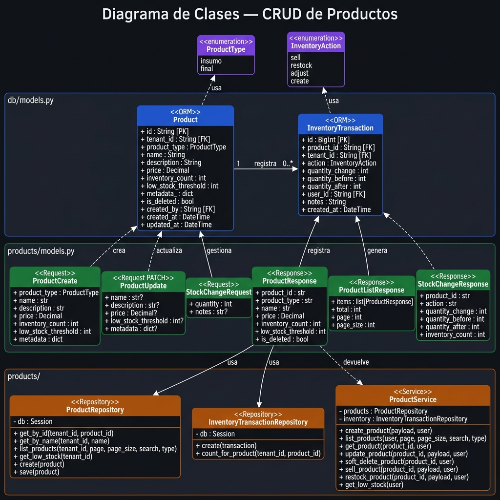
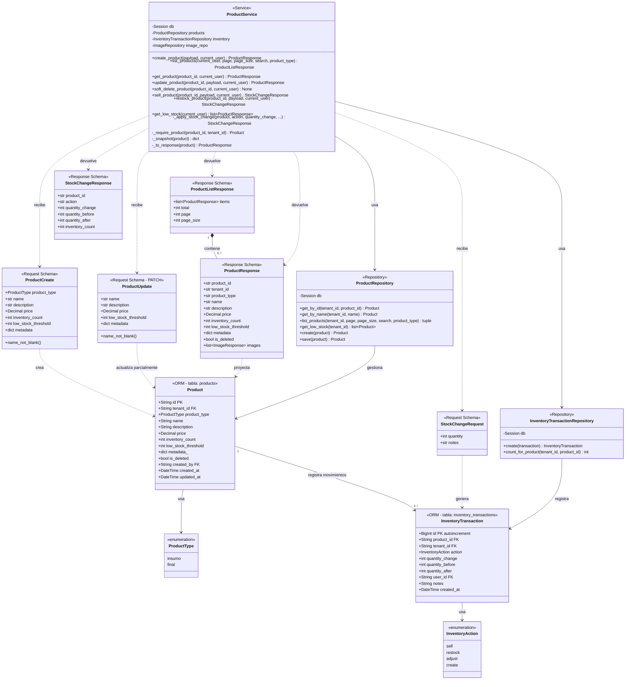

# Diagrama de Clases — Módulo de Productos

Cubre las capas: **ORM (DB)**, **Pydantic Schemas**, **Repository** y **Service**.

---

## Vista General

---

## Diagrama (Mermaid interactivo)

---

## Descripción de Capas

### 🗄️ ORM Models (`db/models.py`)
Mapean directamente a tablas PostgreSQL. `Product` es la entidad central; `InventoryTransaction` es un log **inmutable** de cada movimiento de stock — nunca se actualiza ni elimina.

### 📋 Pydantic Schemas (`products/models.py`)
- **Request**: `ProductCreate`, `ProductUpdate` (PATCH parcial), `StockChangeRequest`
- **Response**: `ProductResponse`, `ProductListResponse`, `StockChangeResponse`
- `inventory_count` está **excluido** de `ProductUpdate` — el stock solo cambia vía `/sell` y `/restock` para mantener la traza de auditoría.

### 🔎 Repository (`products/repository.py`)
Capa de acceso a datos sin lógica de negocio. **Toda query filtra por `tenant_id`** — aislamiento multi-tenant garantizado. `InventoryTransactionRepository` es append-only por diseño.

### ⚙️ Service (`products/service.py`)
Contiene todas las reglas de negocio:
- Valida metadata JSONB contra el schema del `business_type` del tenant
- Previene nombres duplicados por tenant
- Garantiza que el stock nunca baje de cero
- Aplica venta/reabastecimiento + `InventoryTransaction` en una sola transacción atómica
- Escribe el audit log en cada operación

---

## Invariantes Clave

| Regla | Implementación |
|---|---|
| Stock nunca negativo | Check en `sell_product` + constraint DB `products_inventory_non_negative` |
| Nombre único por tenant | Constraint `uq_product_name_tenant` + check en servicio |
| Soft-delete (no hard delete) | `is_deleted = True`, nunca `DELETE` |
| `tenant_id` solo del JWT | Siempre `current_user.tenant_id`, nunca del body |
| Transacción atómica en stock | `product.inventory_count` + `InventoryTransaction` en mismo `db.commit()` |
