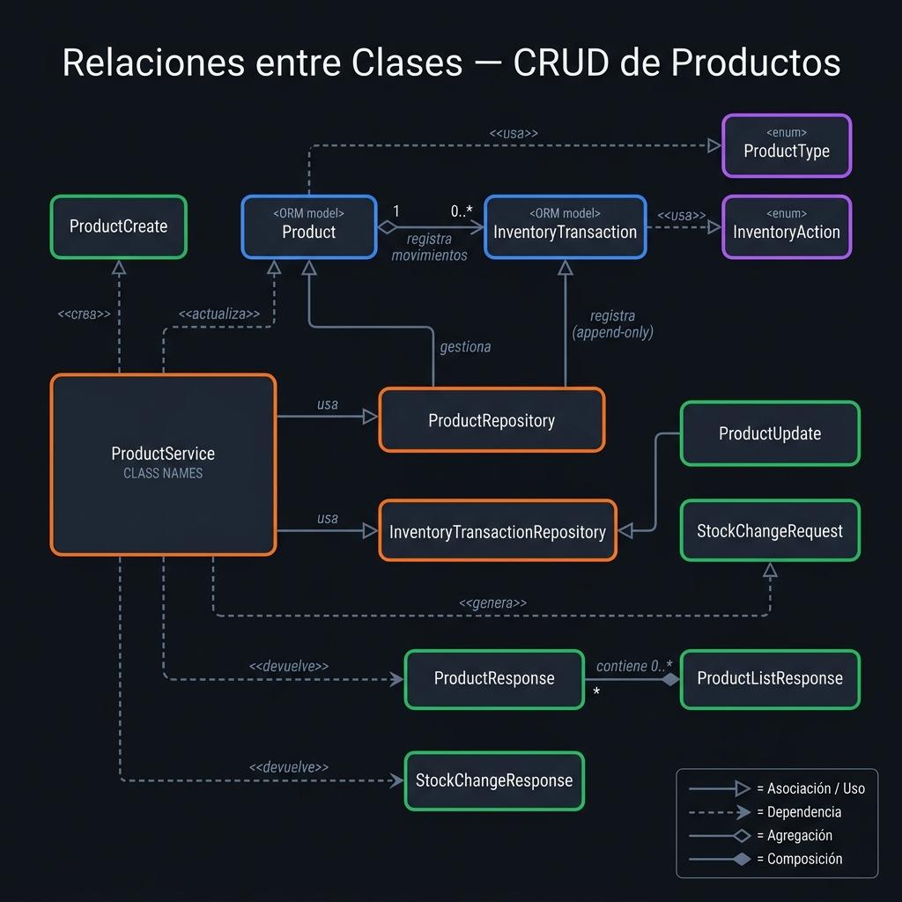

# Código 3 — Relaciones entre Clases

Diagrama enfocado exclusivamente en las **relaciones UML** entre las clases del módulo de productos (sin atributos ni métodos, solo las conexiones).

---

## Diagrama

---

## Tipos de Relaciones Aplicadas

| Relación | Notación UML | Pares en el sistema |
|---|---|---|
| **Asociación / Uso** | → (línea sólida + flecha abierta) | `ProductService → ProductRepository`, `ProductService → InventoryTransactionRepository`, `ProductRepository → Product`, `InventoryTransactionRepository → InventoryTransaction` |
| **Agregación** | ◇→ (diamante abierto) | `Product ◇→ InventoryTransaction` — un producto *tiene* 0..* transacciones, pero las transacciones son independientes |
| **Composición** | ◆→ (diamante relleno) | `ProductListResponse ◆→ ProductResponse` — la lista *contiene* respuestas; no existen sin ella |
| **Dependencia** | ⇢ (línea punteada) | Schemas → ORM: `ProductCreate ⇢ Product`, `ProductUpdate ⇢ Product`, `StockChangeRequest ⇢ InventoryTransaction`, `ProductService ⇢ ProductResponse`, `ProductService ⇢ StockChangeResponse`, `Product ⇢ ProductType`, `InventoryTransaction ⇢ InventoryAction` |

---

## Tabla de Relaciones

| Clase origen | Tipo | Clase destino | Cardinalidad | Descripción |
|---|---|---|---|---|
| `ProductService` | Asociación | `ProductRepository` | 1 → 1 | El servicio usa el repositorio para acceso a datos |
| `ProductService` | Asociación | `InventoryTransactionRepository` | 1 → 1 | El servicio registra movimientos de stock |
| `ProductRepository` | Asociación | `Product` | 1 → 0..* | El repositorio gestiona entidades Product |
| `InventoryTransactionRepository` | Asociación | `InventoryTransaction` | 1 → 0..* | Append-only: solo crea, nunca modifica |
| `Product` | Agregación | `InventoryTransaction` | 1 → 0..* | Un producto origina múltiples transacciones de inventario |
| `ProductListResponse` | Composición | `ProductResponse` | 1 → 0..* | La lista contiene y agrupa las respuestas individuales |
| `ProductCreate` | Dependencia | `Product` | — | El schema de creación define los datos para instanciar Product |
| `ProductUpdate` | Dependencia | `Product` | — | El schema de actualización parcial modifica un Product existente |
| `StockChangeRequest` | Dependencia | `InventoryTransaction` | — | La solicitud de venta/reabastecimiento genera una transacción |
| `ProductService` | Dependencia | `ProductResponse` | — | El servicio produce este DTO como salida |
| `ProductService` | Dependencia | `StockChangeResponse` | — | El servicio produce este DTO tras venta/reabastecimiento |
| `Product` | Dependencia | `ProductType` | — | Usa el enum para tipar el campo product_type |
| `InventoryTransaction` | Dependencia | `InventoryAction` | — | Usa el enum para tipar el campo action |

---

## Principio Aplicado: SRP (Single Responsibility Principle)

Cada clase tiene **una sola razón para cambiar**:

- `ProductRepository` → solo cambia si cambia la forma de consultar la BD
- `ProductService` → solo cambia si cambia la lógica de negocio
- `ProductCreate` / `ProductUpdate` → solo cambian si cambia el contrato de la API de entrada
- `ProductResponse` → solo cambia si cambia el contrato de la API de salida
