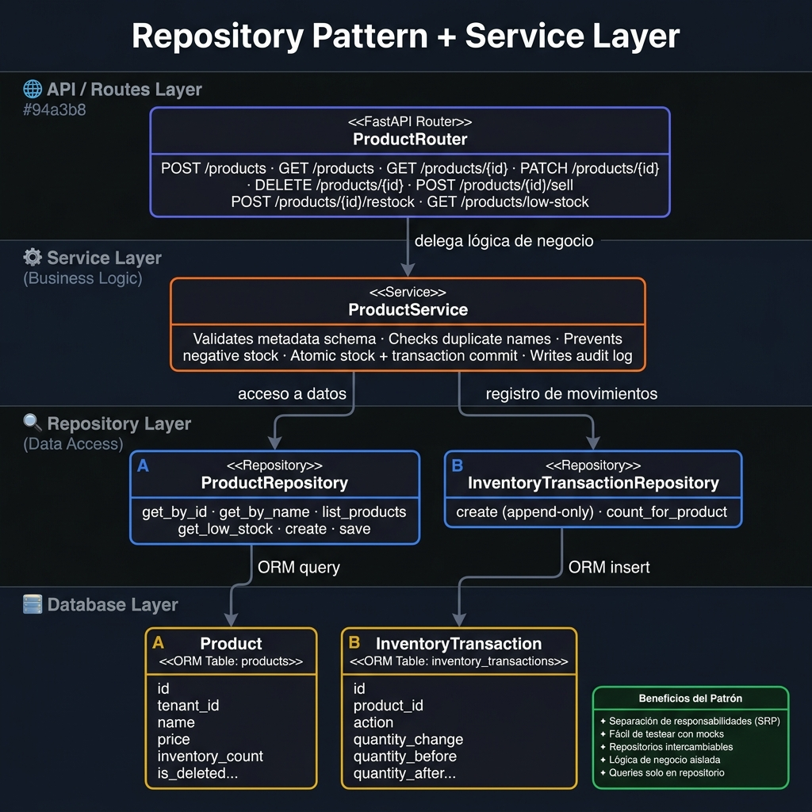

# Código 6 — Patrón de Diseño: Repository Pattern

## Patrón Aplicado

**Repository Pattern** combinado con **Service Layer** (patrón de capas).

Clasificación según GoF: es un patrón **estructural** de arquitectura de datos.

---

## Diagrama del Patrón



---

## Descripción

El **Repository Pattern** abstrae el acceso a la base de datos detrás de una interfaz orientada a objetos. El resto del sistema (service layer) nunca escribe queries SQL directamente — simplemente llama métodos con nombres del dominio (`get_by_id`, `list_products`, `create`).

### Estructura en el proyecto KARD

```
Router (routes.py)
    ↓  delega
Service (service.py)       ← lógica de negocio
    ↓  usa
Repository (repository.py) ← acceso a datos
    ↓  consulta
ORM Model (db/models.py)   ← mapeado a tabla SQL
```

---

## Implementación Real en el Código

### Repositorio de Productos (`products/repository.py`)

```python
class ProductRepository:
    """Acceso a datos siempre filtrado por tenant_id."""

    def __init__(self, db: Session):
        self.db = db

    def get_by_id(self, tenant_id: str, product_id: str) -> Optional[Product]:
        return (
            self.db.query(Product)
            .filter(
                Product.tenant_id == tenant_id,
                Product.id == product_id,
                Product.is_deleted.is_(False)
            )
            .first()
        )

    def list_products(self, tenant_id, page, page_size, search=None, product_type=None):
        query = self.db.query(Product).filter(
            Product.tenant_id == tenant_id,
            Product.is_deleted.is_(False)
        )
        if search:
            query = query.filter(Product.name.ilike(f"%{search}%"))
        if product_type:
            query = query.filter(Product.product_type == product_type)
        total = query.count()
        items = query.order_by(Product.created_at.desc()) \
                     .offset((page - 1) * page_size).limit(page_size).all()
        return items, total

    def create(self, product: Product) -> Product:
        self.db.add(product)
        self.db.flush()
        return product

    def save(self, product: Product) -> Product:
        self.db.add(product)
        self.db.flush()
        return product
```

### Servicio consumiendo el repositorio (`products/service.py`)

```python
class ProductService:
    def __init__(self, db: Session):
        self.products = ProductRepository(db)          # ← inyección
        self.inventory = InventoryTransactionRepository(db)

    def create_product(self, payload: ProductCreate, current_user) -> ProductResponse:
        validate_metadata(current_user.business_type, payload.metadata)

        if self.products.get_by_name(current_user.tenant_id, payload.name):
            raise DuplicateProductNameError(payload.name)

        product = Product(id=generate_id("p"), ...)
        self.products.create(product)   # ← llama al repo, no escribe SQL
        self.db.commit()
        return self._to_response(product)

    def sell_product(self, product_id, payload, current_user) -> StockChangeResponse:
        product = self._require_product(product_id, current_user.tenant_id)
        if payload.quantity > product.inventory_count:
            raise InsufficientStockError(...)
        return self._apply_stock_change(product, "sell", -payload.quantity, ...)
```

---

## Principios de Diseño Respetados

| Principio | Cómo se aplica |
|---|---|
| **SRP** (Single Responsibility) | Router solo enruta · Service solo lógica · Repository solo queries |
| **DIP** (Dependency Inversion) | El servicio depende de la abstracción del repositorio, no de SQLAlchemy directamente |
| **OCP** (Open/Closed) | Para cambiar de PostgreSQL a otro motor solo se reemplaza el repositorio, sin tocar el servicio |
| **Aislamiento multi-tenant** | Toda query en el repositorio filtra obligatoriamente por `tenant_id` |

---

## Beneficios Observados en el Proyecto

1. **Testabilidad** — El servicio puede testearse con un repositorio mock sin necesidad de BD real
2. **Seguridad** — Toda query lleva `tenant_id` en el repositorio; imposible olvidarlo en el servicio
3. **Legibilidad** — `self.products.get_low_stock(tenant_id)` es más claro que un query inline
4. **Atomicidad** — `ProductService._apply_stock_change` actualiza `Product.inventory_count` y crea `InventoryTransaction` en un mismo `db.commit()`, garantizando consistencia

---

## Patrón Adicional: Soft Delete

El proyecto implementa también el patrón **Soft Delete**:

```python
def soft_delete_product(self, product_id, current_user) -> None:
    product = self._require_product(product_id, current_user.tenant_id)
    product.is_deleted = True   # ← nunca DELETE, solo flag
    self.products.save(product)
    self.db.commit()
```

Esto permite **auditoría histórica completa** — ningún producto desaparece físicamente de la base de datos.
