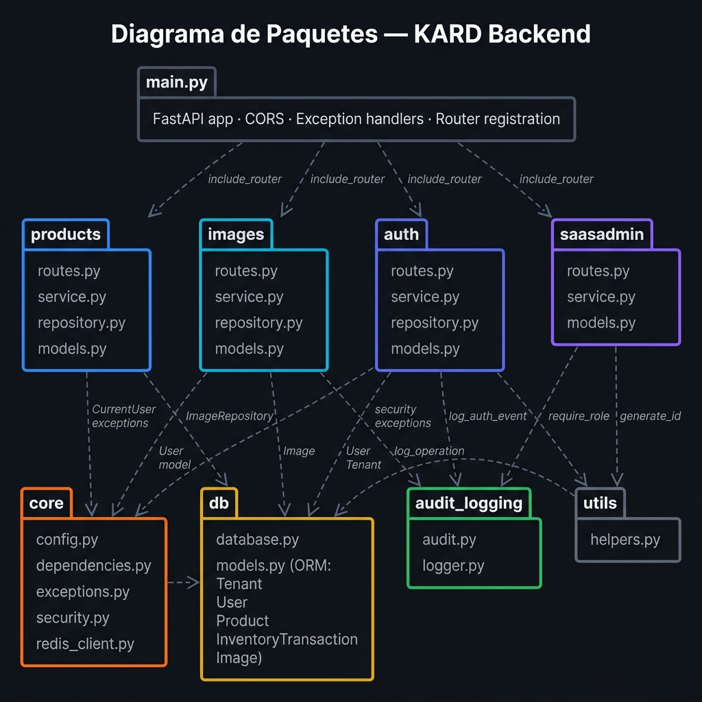
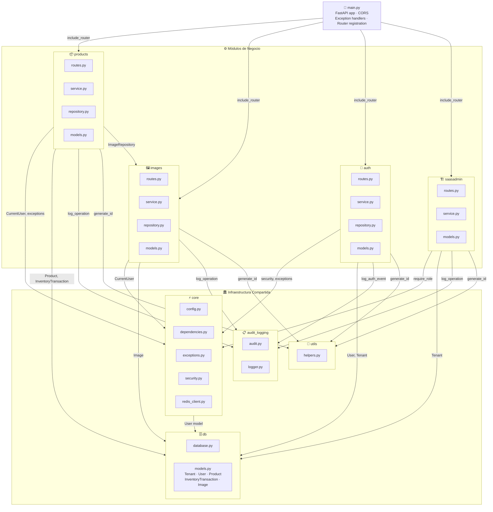

# Diagrama de Paquetes — KARD Backend

Muestra la organización modular del backend y las dependencias entre paquetes.

---

## Vista General



---

## Diagrama (Mermaid interactivo)



---

## Descripción de Paquetes

### 📄 `main.py` — Punto de entrada
Arranca la aplicación FastAPI. Registra todos los routers de feature con su prefijo `/api/v1/...`, configura CORS y mapea excepciones de dominio a respuestas HTTP.

---

### ⚙️ Módulos de Negocio

| Paquete | Responsabilidad | Router prefix |
|---|---|---|
| **`products`** | Catálogo de productos + gestión de inventario (venta, reabastecimiento, alertas) | `/api/v1/products` |
| **`images`** | Imágenes asociadas a productos (CRUD de assets URL-based) | `/api/v1/products/{id}/images` |
| **`auth`** | Registro de usuarios, login, JWT, bloqueo anti-fuerza bruta | `/api/v1/auth` |
| **`saasadmin`** | Gestión de tenants (solo `saas_admin`) | `/api/v1/saasadmin` |

Cada módulo sigue la misma arquitectura interna en capas:
```
routes.py  →  service.py  →  repository.py  →  db/models.py
```

---

### 🏛️ Infraestructura Compartida

| Paquete | Contenido | Usado por |
|---|---|---|
| **`core`** | `config`, `dependencies` (JWT/CurrentUser), `exceptions`, `security` (hash/token), `redis_client` | Todos los módulos |
| **`db`** | `database.py` (sesión SQLAlchemy), `models.py` (ORM: Tenant, User, Product, InventoryTransaction, Image) | Todos los módulos |
| **`audit_logging`** | `audit.py` (log_operation, log_auth_event), `logger.py` (setup) | products, images, auth, saasadmin |
| **`utils`** | `helpers.py` (generate_id) | products, images, auth, saasadmin |

---

## Reglas de Dependencia

> [!IMPORTANT]
> Las dependencias fluyen **siempre hacia abajo** en la jerarquía. Ningún paquete de infraestructura (`core`, `db`, `utils`) depende de los módulos de negocio.

> [!NOTE]
> `products` depende de `images` únicamente para leer el `ImageRepository` al construir el `ProductResponse`. Esta es la única dependencia **lateral** entre módulos de negocio.
