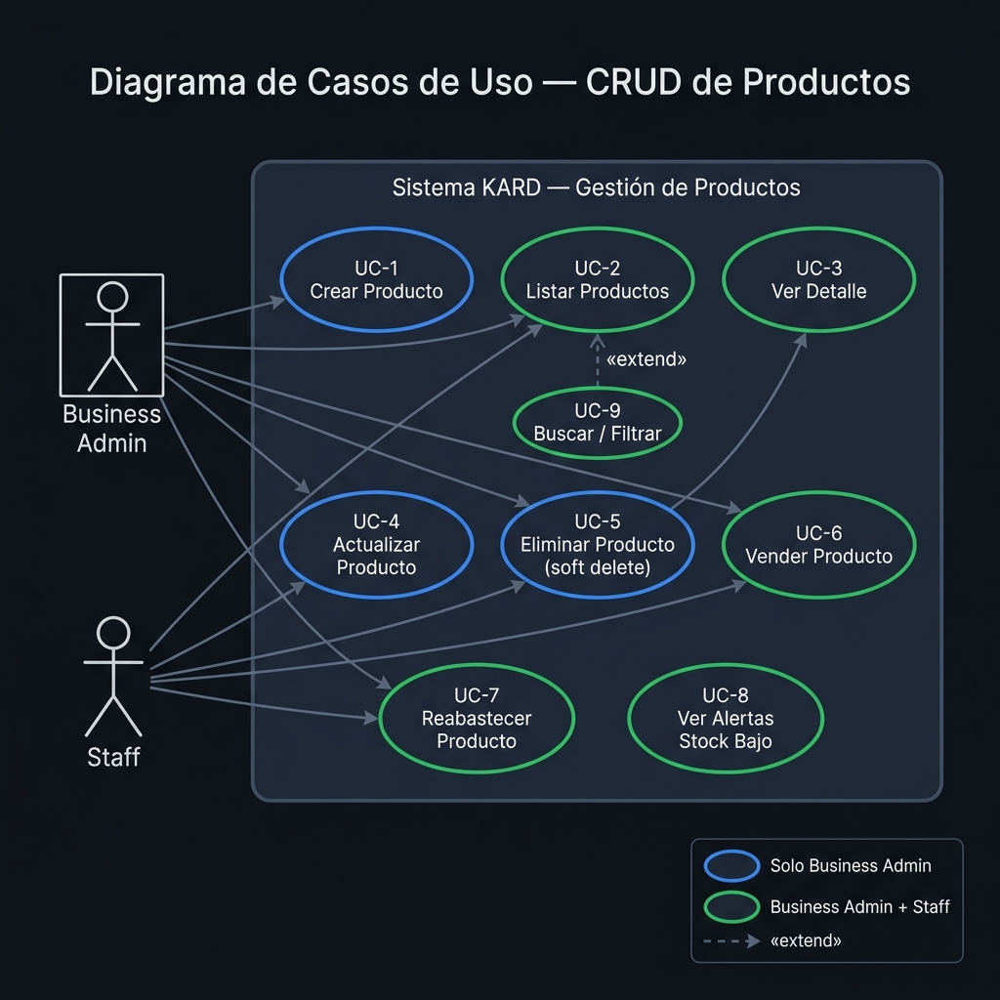
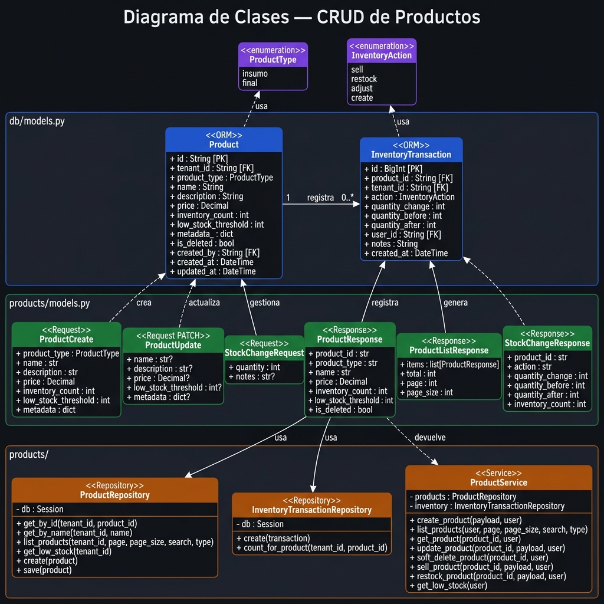
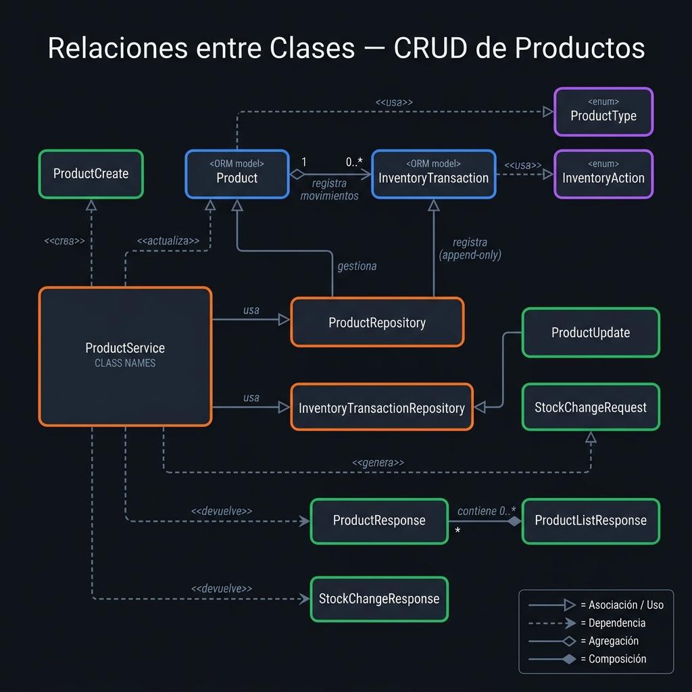
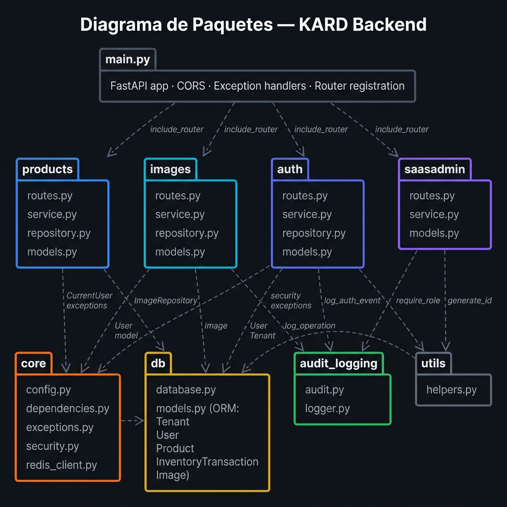
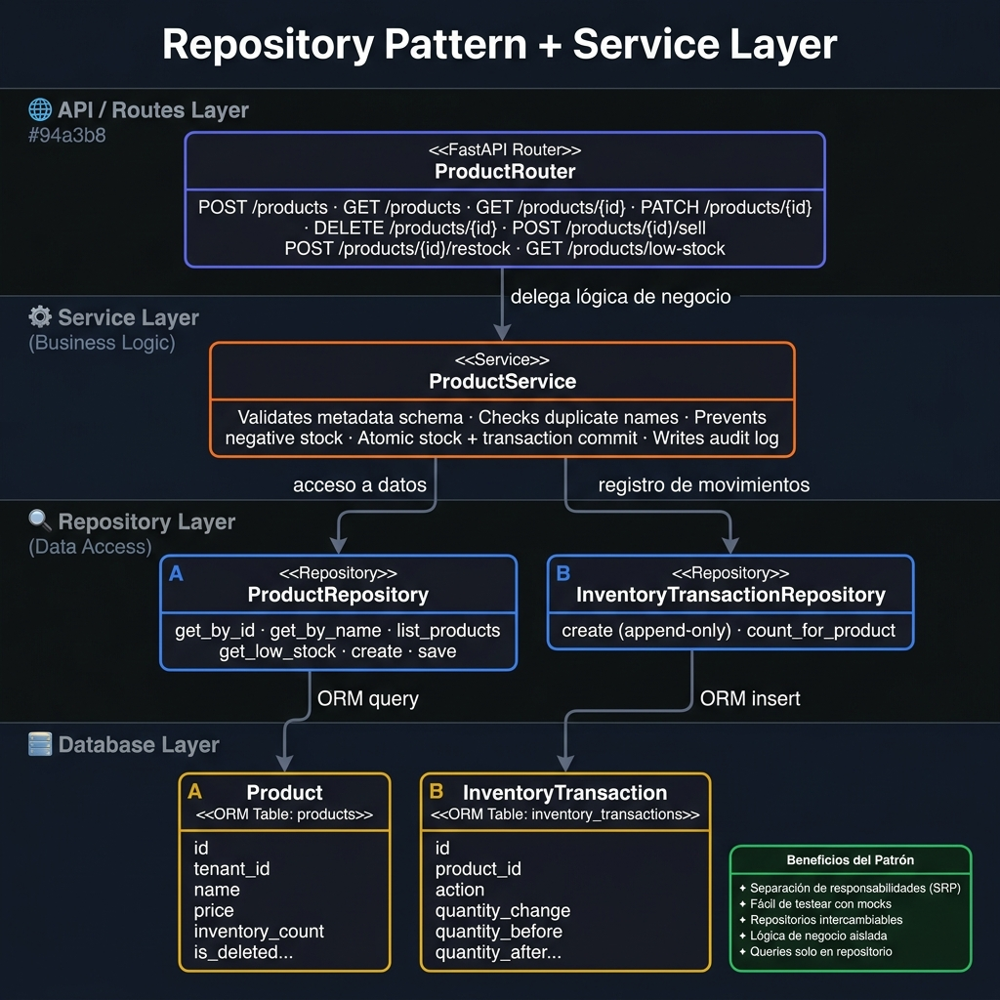

# KARD — Sistema de Administración de Productos

**Materia:** Arquitectura orientada a servicios
**Alumno:** Octavio Sanchez Mendoza
**Fecha:** Junio 2026
**Arquitectura:** FastAPI (Backend Python) + Angular (Frontend Node)
**Patrón de Diseño:** Repository Pattern + Service Layer

---

## Índice

| Código | Contenido | Valor |
|---|---|---|
| Código 1 | Diagrama de Casos de Uso | 4 pts |
| Código 2 | Diagrama de Clases | 4 pts |
| Código 3 | Relaciones entre Clases | 4 pts |
| Código 4 | Diagrama de Paquetes | 4 pts |
| Código 6 | Patrón de Diseño: Repository Pattern | — |

---

## Descripción del Sistema

**KARD** es una plataforma SaaS multi-tenant para administración de catálogos de productos e inventario. Permite las operaciones básicas CRUD (Alta, Baja, Consulta, Modificación), así como operaciones de inventario como venta y reabastecimiento de productos.

### Stack Tecnológico

| Capa | Tecnología |
|---|---|
| Backend | Python · FastAPI · SQLAlchemy · Pydantic |
| Frontend | Angular · TypeScript · SCSS |
| Base de Datos | PostgreSQL |
| Caché / Seguridad | Redis (anti-brute-force) |
| Autenticación | JWT Bearer Token |
| Contenedores | Docker · docker-compose |


---

## Código 1 — Diagrama de Casos de Uso

### Descripción

Muestra los actores del sistema y las operaciones que cada uno puede realizar. Cubre los requisitos **R1** (Alta, Baja, Consulta, Modificación) y **R3** (vender producto).



### Casos de Uso

| # | Caso de Uso | Business Admin | Staff | Endpoint |
|---|---|:---:|:---:|---|
| UC-1 | **Crear Producto** (Alta) | ✅ | ❌ | `POST /api/v1/products` |
| UC-2 | **Listar Productos** (Consulta) | ✅ | ✅ | `GET /api/v1/products` |
| UC-3 | **Ver Detalle de Producto** (Consulta) | ✅ | ✅ | `GET /api/v1/products/{id}` |
| UC-4 | **Actualizar Producto** (Modificación) | ✅ | ❌ | `PATCH /api/v1/products/{id}` |
| UC-5 | **Eliminar Producto** (Baja — soft delete) | ✅ | ❌ | `DELETE /api/v1/products/{id}` |
| UC-6 | **Vender Producto** — disminuir stock (R3) | ✅ | ✅ | `POST /api/v1/products/{id}/sell` |
| UC-7 | **Reabastecer Producto** — aumentar stock | ✅ | ✅ | `POST /api/v1/products/{id}/restock` |
| UC-8 | **Ver Alertas de Stock Bajo** | ✅ | ✅ | `GET /api/v1/products/low-stock` |
| UC-9 | **Buscar / Filtrar** (extensión de UC-2) | ✅ | ✅ | Query params: `search`, `product_type` |

> **R3 cumplido:** UC-6 implementa la disminución del inventario. El sistema valida que el stock resultante nunca sea negativo antes de aplicar la operación.

---

## Código 2 — Diagrama de Clases

### Descripción

Muestra la estructura interna del módulo de productos en 4 capas, aplicando los principios de diseño **SRP**, **DIP** y **OCP**.



### Capas del Diagrama

| Capa | Clases |
|---|---|
| 🟣 **Enums** | `ProductType` (insumo / final) · `InventoryAction` (sell / restock / adjust / create) |
| 🔵 **ORM Models** | `Product` (tabla: products) · `InventoryTransaction` (tabla: inventory_transactions) |
| 🟢 **Pydantic Schemas** | `ProductCreate` · `ProductUpdate` · `StockChangeRequest` · `ProductResponse` · `ProductListResponse` · `StockChangeResponse` |
| 🟠 **Service & Repository** | `ProductService` · `ProductRepository` · `InventoryTransactionRepository` |

### Principios de Diseño Aplicados (R4)

| Principio | Aplicación |
|---|---|
| **SRP** — Single Responsibility | Router solo enruta · Service solo lógica · Repository solo queries · Schemas solo validación |
| **DIP** — Dependency Inversion | El Service depende de la abstracción `ProductRepository`, no de SQLAlchemy directamente |
| **OCP** — Open/Closed | Para cambiar de motor de BD se reemplaza solo el repositorio; el servicio no cambia |

---

## Código 3 — Relaciones entre Clases

### Descripción

Diagrama enfocado exclusivamente en las **relaciones UML** entre las clases del módulo de productos: asociaciones, agregaciones, composiciones y dependencias.



### Tipos de Relaciones Identificadas

| Tipo | Notación | Pares en el sistema |
|---|---|---|
| **Asociación / Uso** | → (línea sólida) | `ProductService → ProductRepository` · `ProductService → InventoryTransactionRepository` · `ProductRepository → Product` |
| **Agregación** | ◇→ (diamante abierto) | `Product 1 ◇→ 0..* InventoryTransaction` — el producto tiene transacciones independientes |
| **Composición** | ◆→ (diamante relleno) | `ProductListResponse ◆→ ProductResponse` — la lista contiene respuestas que no existen sin ella |
| **Dependencia** | ⇢ (línea punteada) | `ProductCreate ⇢ Product` · `ProductUpdate ⇢ Product` · `StockChangeRequest ⇢ InventoryTransaction` · `Product ⇢ ProductType` · `InventoryTransaction ⇢ InventoryAction` |

### Tabla de Relaciones Completa

| Clase origen | Tipo | Clase destino | Cardinalidad |
|---|---|---|---|
| `ProductService` | Asociación | `ProductRepository` | 1 → 1 |
| `ProductService` | Asociación | `InventoryTransactionRepository` | 1 → 1 |
| `ProductRepository` | Asociación | `Product` | 1 → 0..* |
| `InventoryTransactionRepository` | Asociación | `InventoryTransaction` | 1 → 0..* |
| `Product` | Agregación | `InventoryTransaction` | 1 → 0..* |
| `ProductListResponse` | Composición | `ProductResponse` | 1 → 0..* |
| `ProductCreate` | Dependencia | `Product` | — |
| `ProductUpdate` | Dependencia | `Product` | — |
| `StockChangeRequest` | Dependencia | `InventoryTransaction` | — |
| `Product` | Dependencia | `ProductType` | — |
| `InventoryTransaction` | Dependencia | `InventoryAction` | — |

---

## Código 4 — Diagrama de Paquetes

### Descripción

Muestra la organización modular del backend y las dependencias entre paquetes. Las dependencias fluyen siempre hacia abajo (negocio → infraestructura).



### Descripción de Paquetes

| Paquete | Capa | Responsabilidad |
|---|---|---|
| `main.py` | Entrada | Arranca FastAPI, registra routers, configura CORS y manejadores de excepción |
| `products` | Negocio | CRUD de productos + gestión de inventario (venta, reabastecimiento, alertas) |
| `images` | Negocio | Imágenes asociadas a productos (URL-based) |
| `auth` | Negocio | Registro de usuarios, login, JWT, anti-brute-force |
| `saasadmin` | Negocio | Gestión de tenants (solo saas_admin) |
| `core` | Infraestructura | Configuración, JWT/CurrentUser, excepciones, seguridad, Redis |
| `db` | Infraestructura | Sesión SQLAlchemy + ORM models (Tenant, User, Product, InventoryTransaction, Image) |
| `audit_logging` | Infraestructura | Trazabilidad de todas las operaciones del sistema |
| `utils` | Infraestructura | `generate_id()` — generación de IDs únicos con prefijo |

### R2 — Separación Cliente / Servidor

| Componente | Tecnología | Comunicación |
|---|---|---|
| **Servidor (Backend)** | Python · FastAPI | REST API JSON sobre HTTP (`/api/v1/...`) |
| **Cliente (Frontend)** | Angular · TypeScript | Consume la API mediante servicios HTTP |

---

## Código 6 — Patrón de Diseño: Repository Pattern

### Patrón Aplicado

**Repository Pattern** combinado con **Service Layer**.

- **Categoría:** Patrón estructural de arquitectura de datos
- **Propósito:** Abstraer el acceso a la base de datos detrás de una interfaz orientada a objetos

### Diagrama del Patrón



### Estructura del Patrón en KARD

```
Router  (routes.py)       ← solo enruta, delega al servicio
    ↓
Service (service.py)      ← lógica de negocio
    ↓
Repository (repository.py) ← acceso a datos (solo queries)
    ↓
ORM Model (db/models.py)  ← mapeado a tabla PostgreSQL
```

### Implementación Real — Repositorio de Productos

```python
class ProductRepository:
    """Acceso a datos siempre filtrado por tenant_id."""

    def __init__(self, db: Session):
        self.db = db

    def get_by_id(self, tenant_id: str, product_id: str) -> Optional[Product]:
        return (
            self.db.query(Product)
            .filter(
                Product.tenant_id == tenant_id,
                Product.id == product_id,
                Product.is_deleted.is_(False)
            )
            .first()
        )

    def get_low_stock(self, tenant_id: str) -> list[Product]:
        return (
            self.db.query(Product)
            .filter(
                Product.tenant_id == tenant_id,
                Product.is_deleted.is_(False),
                Product.inventory_count < Product.low_stock_threshold,
            )
            .order_by(Product.inventory_count.asc()).all()
        )
```

### Implementación Real — Venta de Producto (R3)

```python
def sell_product(self, product_id, payload, current_user) -> StockChangeResponse:
    """Disminuye el stock. Nunca puede quedar negativo."""
    product = self._require_product(product_id, current_user.tenant_id)

    if payload.quantity > product.inventory_count:
        raise InsufficientStockError(
            f"No se pueden vender {payload.quantity} unidades "
            f"— solo {product.inventory_count} en stock"
        )

    return self._apply_stock_change(
        product=product,
        action="sell",
        quantity_change=-payload.quantity,  # negativo = reducción
        current_user=current_user,
        notes=payload.notes,
        audit_action="SELL_PRODUCT",
    )
```

### Beneficios del Patrón

| Beneficio | Explicación |
|---|---|
| **Separación de responsabilidades** | Cada capa tiene una única razón para cambiar (SRP) |
| **Testabilidad** | El servicio puede testearse con un repositorio mock sin BD real |
| **Seguridad multi-tenant** | Toda query lleva `tenant_id` en el repositorio — imposible olvidarlo |
| **Atomicidad** | Venta + `InventoryTransaction` en un solo `db.commit()` |
| **Soft Delete** | `is_deleted = True` — nunca se borra físicamente, auditoría completa |

### Patrón Adicional: Soft Delete

```python
def soft_delete_product(self, product_id, current_user) -> None:
    product = self._require_product(product_id, current_user.tenant_id)
    product.is_deleted = True   # nunca DELETE, solo flag
    self.products.save(product)
    self.db.commit()
```

El producto nunca desaparece físicamente de la BD, permitiendo auditoría histórica completa.

---

*KARD — Ejercicio 1 · Modelado de Requisitos · Junio 2026*
