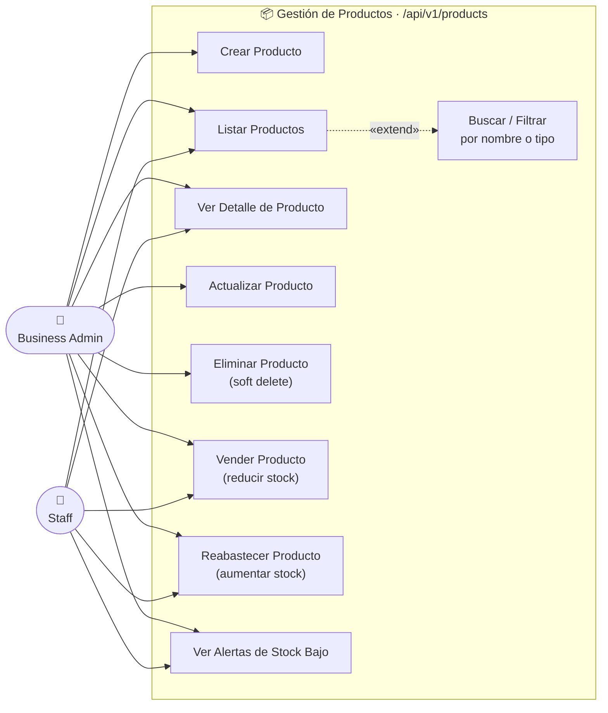

# Diagrama de Casos de Uso — CRUD de Productos

## Actores

| Actor | Descripción |
|---|---|
| **Business Admin** | Administrador del negocio. Acceso completo al catálogo e inventario de su tenant. |
| **Staff** | Empleado. Solo lectura y operaciones de inventario (vender / reabastecer). |

---

## Diagrama

---

## Casos de Uso

| # | Caso de Uso | Business Admin | Staff | Método | Endpoint |
|---|---|:---:|:---:|---|---|
| UC-1 | **Crear Producto** | ✅ | ❌ | `POST` | `/api/v1/products` |
| UC-2 | **Listar Productos** | ✅ | ✅ | `GET` | `/api/v1/products` |
| UC-3 | **Ver Detalle de Producto** | ✅ | ✅ | `GET` | `/api/v1/products/{id}` |
| UC-4 | **Actualizar Producto** | ✅ | ❌ | `PATCH` | `/api/v1/products/{id}` |
| UC-5 | **Eliminar Producto** | ✅ | ❌ | `DELETE` | `/api/v1/products/{id}` |
| UC-6 | **Vender Producto** | ✅ | ✅ | `POST` | `/api/v1/products/{id}/sell` |
| UC-7 | **Reabastecer Producto** | ✅ | ✅ | `POST` | `/api/v1/products/{id}/restock` |
| UC-8 | **Ver Alertas de Stock Bajo** | ✅ | ✅ | `GET` | `/api/v1/products/low-stock` |
| UC-9 | **Buscar / Filtrar** | ✅ | ✅ | — | Query params: `search`, `product_type` |
