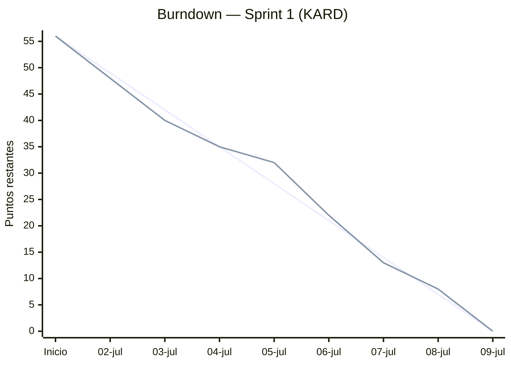

# KARD — Gráfica de Quemado (Burndown Chart)
**Entregable:** Primer Avance · Punto 5 (Metodología Scrum)  
**Sprint 1:** 02-jul-2026 → 09-jul-2026 · Total: 56 SP

---

## 1. Datos del burndown

| Fecha | Día | SP completados | SP restantes (real) | SP restantes (ideal) |
|---|---|:--:|:--:|:--:|
| — (inicio) | — | 0 | 56 | 56 |
| 02-jul | Jue | 8 | 48 | 49 |
| 03-jul | Vie | 8 | 40 | 42 |
| 04-jul | Sáb | 5 | 35 | 35 |
| 05-jul | Dom | 3 | 32 | 28 |
| 06-jul | Lun | 10 | 22 | 21 |
| 07-jul | Mar | 9 | 13 | 14 |
| 08-jul | Mié | 5 | 8 | 7 |
| 09-jul | Jue | 8 | 0 | 0 |

- **Línea ideal:** descenso constante de 7 SP/día.
- **Línea real:** avance efectivo del equipo. El fin de semana (Jul 4-5) el equipo quedó ligeramente por encima de lo ideal, y se recuperó el lunes (Jul 6) con un pico de 10 SP.

---

## 2. Gráfica (se renderiza en GitHub)



> **Línea 1 (referencia):** avance ideal.  
> **Línea 2:** avance real del equipo.

---

## 3. Gráfica alterna (ASCII, por si no renderiza mermaid)

```
SP
56 ●╲                                       ← inicio
   │ ╲╲
49 │  ●··╲       ideal ····
48 │   ●   ╲     real  ●
42 │    ╲●··╲
40 │     ●   ╲
35 │      ●●··╲
32 │       ●   ╲
28 │        ╲·· ╲
22 │         ●   ╲
21 │          ╲···╲
14 │            ╲··●╲
13 │             ●   ╲
 8 │              ●●··╲
 7 │                ╲··╲
 0 │                   ●●   ← sprint completado
   └──┬──┬──┬──┬──┬──┬──┬──┬──┬─
     Ini 02 03 04 05 06 07 08 09  (julio)
```

---

## 4. Interpretación

- ✅ **Sprint completado al 100%** — los 56 SP se quemaron para el 09-jul.
- La línea real siguió de cerca la ideal, con una ligera desviación el fin de semana que se corrigió al inicio de la semana.
- **Velocidad del equipo (velocity):** 56 SP en el Sprint 1 → línea base para planear el Sprint 2.
